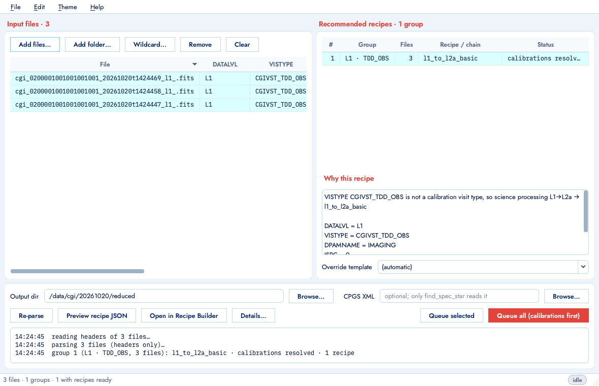

# corgidrp_gui

A desktop GUI wrapper around [corgidrp](https://github.com/roman-corgi/corgidrp), the Roman
Coronagraph data reduction pipeline. It does not modify corgidrp; it imports it.

Tools:

- **Recipe Parser** - load a set of FITS files, see which recipe templates corgidrp
  recommends for each group of files and why, preview the populated recipes, queue them.
- **Recipe Builder** - compose recipes by dragging step functions from a catalog, with
  every keyword argument, its default and its docstring visible; save to the user templates
  folder so the plain walker picks them up too.
- **Status Console** - a queue of recipes, per-step progress read from the walker's own
  console output, logs and tracebacks.
- **Calibration DB** - browse the CalDB, scan folders, add/remove entries, and see which file
  `get_calib` would pick for a given frame.
- **Themes** - whole style systems (palette, type, shape, outline density, shading,
  density), selectable at runtime.

Docs: [user guide](docs/user_guide.md) · [running on a server with xpra](docs/remote_xpra.md) · [developer notes](docs/developing.md) · [changelog](CHANGELOG.md)

Design document: https://claude.ai/artifact/7YrhdbQVzsr1ZNKWgrQf9P

## Install

    conda activate corgidrp          # an environment where corgidrp imports
    pip install -e ".[dev]"
    corgidrp-gui                      # --help for --theme, --tool, --files, --recipe, --queue

## Layout

    corgidrp_gui/core/      Qt-free: step catalog, recipe model, parser, progress parser
    corgidrp_gui/backend/   file-system and process access behind one interface
    corgidrp_gui/ui/        windows and widgets
    corgidrp_gui/themes/    theme token files and the stylesheet template
    corgidrp_gui/runner.py  `python -u -m corgidrp_gui.runner recipe.json`
    tests/                  run against the real corgidrp and its recipe templates
