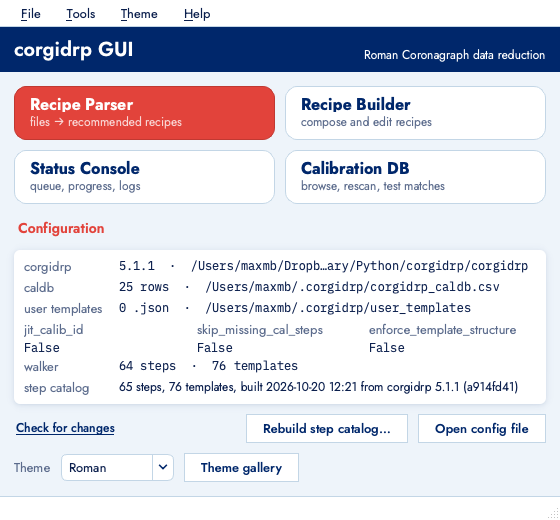
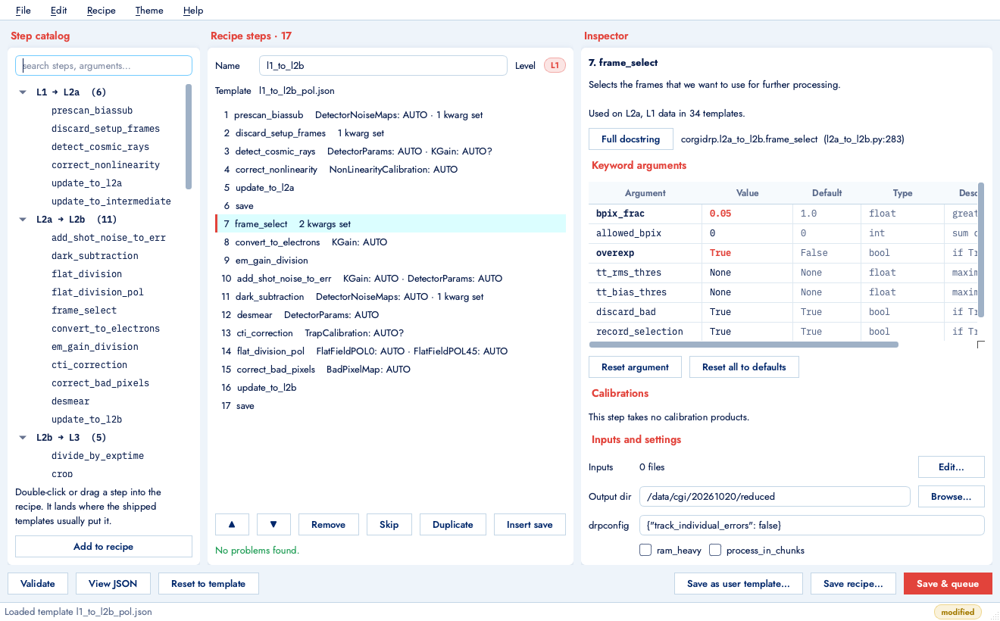
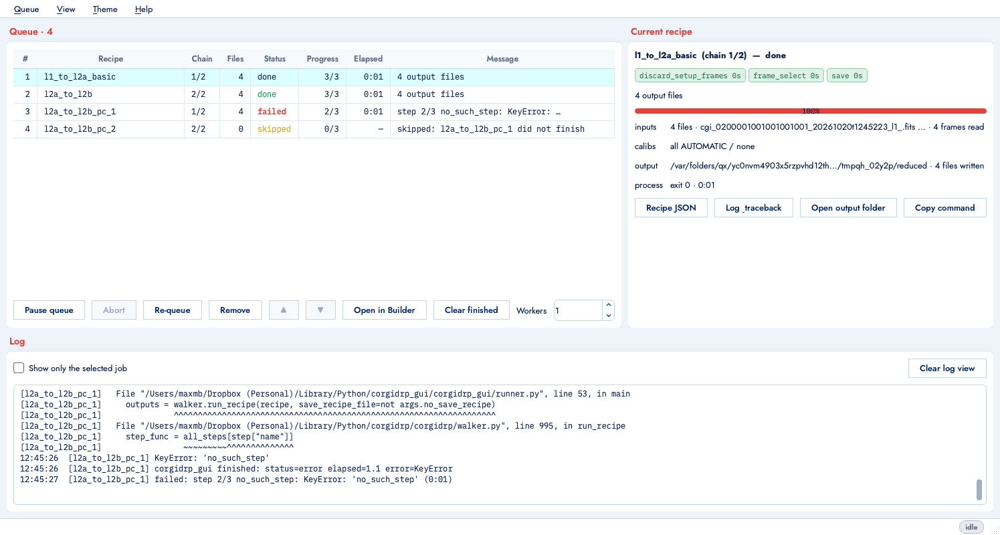
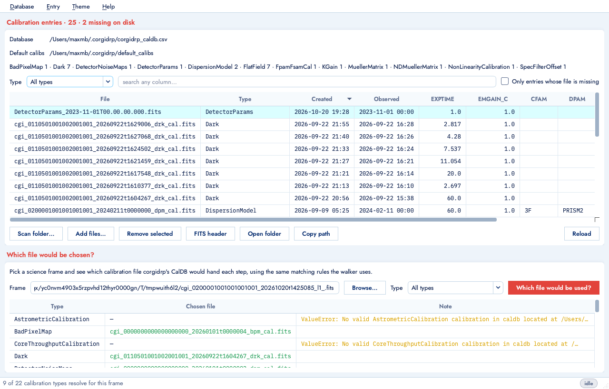
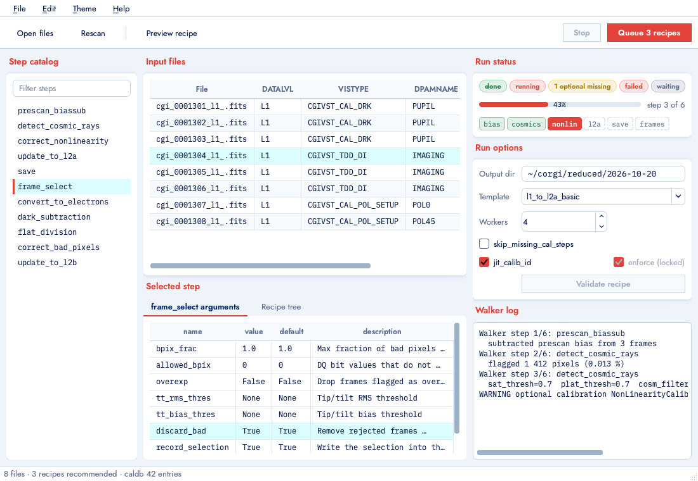
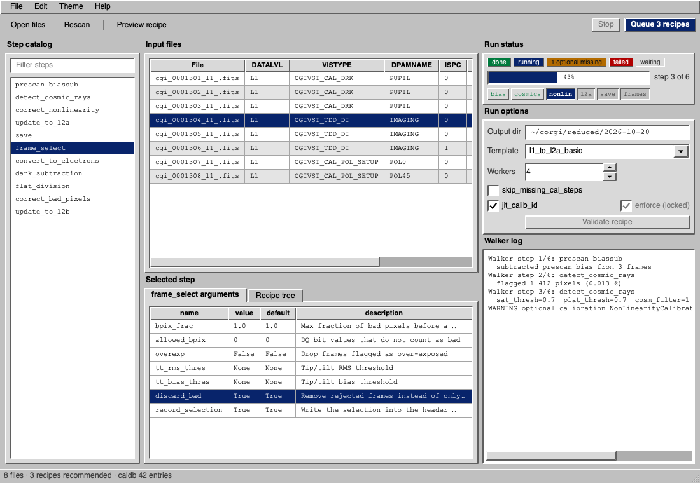
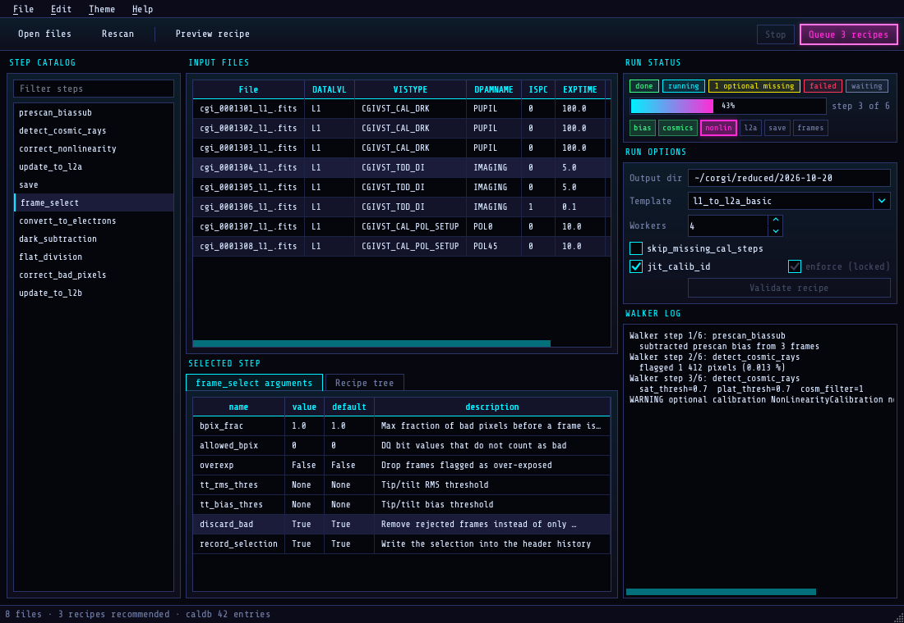
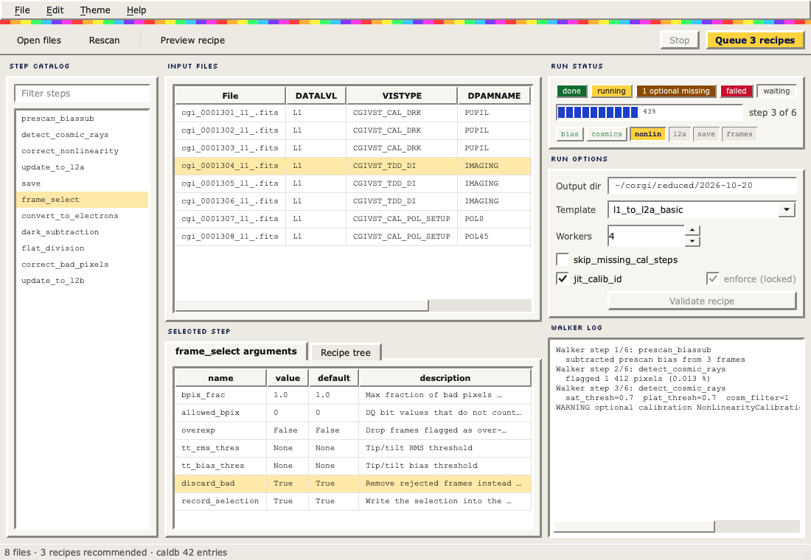
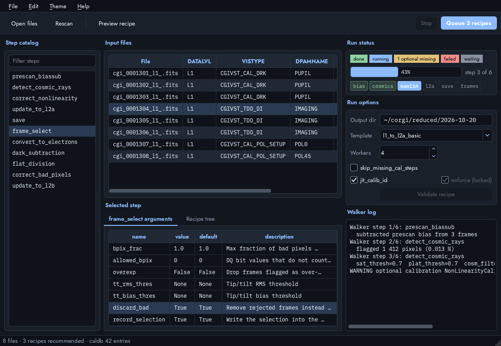

# corgidrp GUI — user guide

A desktop wrapper around [corgidrp](https://github.com/roman-corgi/corgidrp), the Roman
Coronagraph data reduction pipeline. It never modifies corgidrp: it reads the step registry,
the recipe templates and the calibration database, and it runs recipes with the same
`run_recipe` call you would use from Python.

If you have used the GPI pipeline, the mapping is: Data Parser → **Recipe Parser**,
Recipe Editor → **Recipe Builder**, Status Console + Queue Viewer → **Status Console**,
Calibration DB → **Calibration DB**.

## Install and start

Use a Python environment where `corgidrp` imports (on this machine the `corgidrp` conda env).

    conda activate corgidrp
    pip install -e ".[dev]"      # from the corgidrp_gui folder
    corgidrp-gui

Options:

    corgidrp-gui --theme neon                   # this session only
    corgidrp-gui --tool parser --files *.fits   # open the Parser with files loaded
    corgidrp-gui --recipe my_recipe.json        # open a recipe in the Builder
    corgidrp-gui --queue a.json --queue b.json  # queue recipe files straight away

Recipes can also be run without the GUI, exactly as the console does it:

    python -u -m corgidrp_gui.runner recipe.json [--inputs-from list.txt] [--outputdir DIR] [--pdb]

## The Launcher

The Launcher opens the four tools and shows corgidrp's configuration: version and location,
the CalDB file and its row count, the user templates folder, the walker flags, and the state
of the **step catalog**.

The step catalog is the GUI's knowledge of every step function: arguments, defaults,
docstrings, calibration slots, and how the shipped templates use each step. It is built by
introspecting corgidrp and cached in `~/.corgidrp_gui/step_catalog.json`, so the Builder opens
without importing corgidrp. **It is never rebuilt automatically.** When corgidrp changes
(version, git commit, edited sources, added templates), the Launcher says so after
*Check for changes*; rebuild it with *Tools → Rebuild step catalog*. New user templates also
need a rebuild before they appear in the Builder's template lists.

Closing the Launcher closes the application.

## Recipe Parser

1. **Add files** with the buttons (file dialog, whole folder, or a glob pattern such as
   `/data/night1/*_l1_.fits`). Only headers are read. The table shows the keywords the walker
   branches on (DATALVL, VISTYPE, DPAMNAME, ISPC, EXPTIME, EMGAIN_C, KGAINPAR ...). Unreadable
   files are red; double-click a file to open it with the system's default FITS viewer.
2. Files are **grouped** by DATALVL, VISTYPE, DPAMNAME and ISPC, calibration visits first.
   For each group the parser asks corgidrp's `guess_template` which template or chain of
   templates applies, then `autogen_recipe` populates the recipes (inputs, output directory,
   calibration files from the CalDB).
3. The **Status** column tells you whether that worked: *calibrations resolved*, *n optional
   calibrations missing*, *n steps will be skipped* (when `skip_missing_cal_steps` is on), or
   the exact error, including which step and calibration type failed and which file was involved.
4. **Why this recipe** explains the branch `guess_template` took, in words, followed by the
   facts it used (unique exposure settings, whether FSM positions differ, ND filter, prism,
   polarizer).
5. **Override template** forces any shipped or user template, or a recipe file, for the
   selected group. The group is re-resolved immediately and marked *(manual)*.
6. **Preview recipe JSON** shows the populated recipes; **Details** shows corgidrp's own output
   and any traceback; **Open in Recipe Builder** hands the first recipe of the group to the
   Builder with its files attached.
7. **Queue selected** / **Queue all** send the populated recipes to the Status Console, which
   starts running them. Groups that failed to resolve are skipped after a confirmation.
   The **CPGS XML** field is optional and only matters for recipes containing
   `find_spec_star`.

The output directory and last folder are remembered between sessions. *File → Save all recipes
to folder* writes the populated JSON files without running them.

## Recipe Builder

**Step catalog** (left). Every step function grouped by pipeline stage, plus the walker's
`save` instruction. The search box matches step names, argument names and docstring text.
Selecting a step shows its summary and where it would be inserted: the Builder looks at where
the shipped templates put that step relative to the steps already in your recipe. Double-click,
drag into the recipe, or press *Add to recipe*.

**Recipe steps** (middle). Each row shows the step, its calibration slots in short form
(`KGain: AUTO`, `KGain: AUTO?` for optional, `file`, `none`) and how many keyword arguments
differ from their defaults. Drag rows to reorder, or use ▲ ▼. *Remove*, *Skip* (keeps the step
but the walker skips it), *Duplicate* and *Insert save* act on the selection; right-click gives
the same menu. Ctrl+Z undoes structural edits. The line under the list is live validation:
errors (unknown steps, arguments that do not exist, a calibration passed as a keyword) block
queueing; warnings (unusual ordering, a step used on an unexpected data level, no final save)
do not. *Validate* lists everything.

**Inspector** (right). For the selected step: summary, link to the source line, and the full
docstring on request.

- *Keyword arguments*: name, current value, default, documented type and description for
  every argument. Changed values are bold and colored. Edit a value in place; an empty value
  means "back to the default". Booleans get a True/False/None chooser. Dicts, lists and long
  strings open a **pop-out editor** automatically (also available for any argument through
  *Edit in window…*), with JSON formatting, live parse status and *Insert default*. Values are
  parsed as JSON first, then as Python literals, else kept as strings.
- *Calibrations*: one row per slot. The type combo lists what templates and docstrings allow
  for that slot; the spec combo chooses `AUTOMATIC` (the CalDB picks), `AUTOMATIC, OPTIONAL`
  (the step runs without it if none matches), `None`, or **Choose file…**, which opens the
  CalDB chooser: entries of the right type, newest first, plus a browse button that starts in
  their folder.
- *Inputs and settings*: **Add files…** (Ctrl+I) appends FITS files; *Edit list…* reviews
  them. Output directory, `drpconfig` (JSON) and the `ram_heavy` / `process_in_chunks` flags
  live here too. The *Level* chip shows the data level of the inputs, read from the first
  file's DATALVL or guessed from the recipe name.

**Saving and running.** *Save recipe…* writes a runnable recipe. *Save as user template…*
clears inputs and output directory, sets `template: true` and writes into corgidrp's user
templates folder, where the plain walker also finds it (a user template with the same filename
as a shipped one shadows it). *Save & queue* sends the recipe to the Status Console; *View
JSON* shows what will be written; *Reset to template* restores the template you started from
while keeping your inputs.

## Status Console

Every recipe queued from the Parser or Builder becomes a **job**. Jobs from a chain (recipe 2
runs on the outputs of recipe 1) depend on each other; if one fails, the rest of its chain is
marked *skipped*. The queue is saved to `~/.corgidrp_gui/queue` after every change and restored
when the console reopens.

Each job runs in its own process:

    python -u -m corgidrp_gui.runner <recipe>.json [--inputs-from <list>]

*Copy command* puts exactly that line on the clipboard so any run can be reproduced in a
terminal, with `--pdb` for a post-mortem. Progress is read from the walker's own console
output (`Walker step 3/6: detect_cosmic_rays`), so the step strip, the elapsed time per step and
the failing step are whatever the walker printed. Stdout and stderr are merged to keep
tracebacks in order.

Controls: *Pause queue* (running recipes continue), *Abort* (SIGTERM, then SIGKILL after four
seconds), *Re-queue* (also revives skipped dependents), ▲ ▼ to reorder waiting jobs, *Remove*,
*Clear finished*, *Open in Builder*, *Workers* for how many recipes run at once. The right-hand
panel shows the selected or running job: step strip, progress, inputs, explicitly named
calibration files, output folder, process id and exit code. Recipe JSON files can be dropped
onto the window or added from the Queue menu; they need inputs and an output directory.

## Calibration DB

The table is corgidrp's CalDB CSV: file, type, created and observed dates, exposure time, EM
gain, filter and mask names, DRP version, number of input files. Filter by type, search any
column, sort by any header, or show only entries whose file is missing on disk (drawn in red).
*Remove missing entries* drops all of those at once, after confirmation.

*Scan folder…* runs corgidrp's own `scan_dir_for_new_entries`. *Add files…* adds specific
products and rejects anything that is not a calibration type. *Remove selected* drops rows
(never files). *FITS header*, *Open folder* and *Copy path* act on the selection.

**Which file would be chosen?** Pick a science frame and a calibration type, or all types, and
the viewer runs the same `get_calib` matching the walker uses. Each type shows the file that
would be used, or the exact error. This is the quickest way to understand why a Parser group
says a calibration is missing.

## Themes

A theme is a whole style system, not a palette: colors, fonts, corner radius, border style,
how many things get a box, shading, and spacing. Five ship with the GUI (Roman, Console, Neon,
Homepage '98, Midnight); switch from any window's *Theme* menu or the Launcher's combo. The choice is
remembered.

To make your own, copy one of the `.toml` files from `corgidrp_gui/themes/` into
`~/.corgidrp_gui/themes/`, rename it, and edit the values. It appears in the Theme menu at the
next start. See `docs/developing.md` for the sections and what each axis controls.

## Troubleshooting

- **A group says a calibration cannot be resolved.** Open the Calibration DB, pick one of the
  group's files as the frame, and run *Which file would be used?* for that type. The note column
  carries corgidrp's exact reason (no entry of that type, filter mismatch, a file that fails to
  load ...). Entries with missing files are red; remove them or rescan the folder.
- **A default calibration file fails to load with a `KeyError` on a header keyword.** The
  default products in `~/.corgidrp/default_calibs` are written by corgidrp when they are
  missing, so an old file can predate a keyword the current corgidrp expects. Move the file
  aside and import corgidrp once; it regenerates the default.
- **The Builder does not show a new step or template.** Rebuild the step catalog from the
  Launcher.
- **A run fails and you want to debug it.** *Copy command* in the console, paste it into a
  terminal in the same environment, add `--pdb`.
- **Over SSH.** See `docs/remote_xpra.md`.

## Where things live

| What | Where |
|---|---|
| step catalog cache | `~/.corgidrp_gui/step_catalog.json` |
| queued recipe files and queue state | `~/.corgidrp_gui/queue/` |
| custom themes | `~/.corgidrp_gui/themes/*.toml` |
| window geometry, theme choice, last folders | Qt settings (`corgidrp_gui` organization) |
| corgidrp config, CalDB, user templates | `~/.corgidrp/` (corgidrp's own) |

Set `CORGIDRP_GUI_HOME` to relocate the first three.
